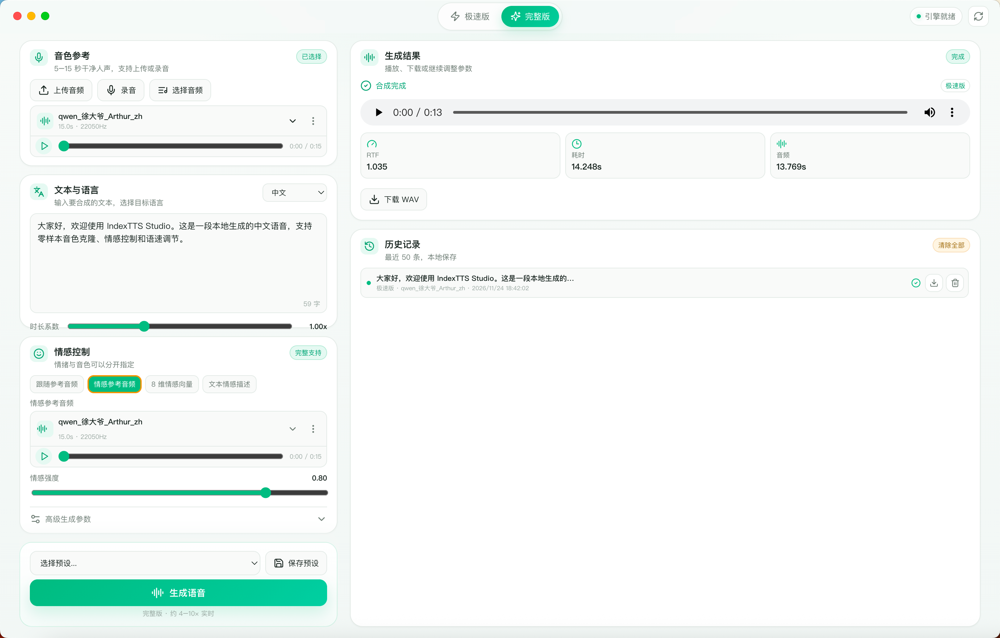

# IndexTTS Studio

Mac 本地的 IndexTTS-2.5 语音克隆工作台，Electron + React + FastAPI，支持双引擎切换：

| 引擎 | 能力 | 速度 |
|---|---|---|
| **极速版（MLX）** | 中文 / 英文 / 日文 / 粤语；参考音频克隆；语速控制 | M1 Max 热态约 0.93× 实时 |
| **完整版（PyTorch MPS）** | 5 语言；4 种情感控制；拼音 / CMU / 假名 | M1 Max 约 4–10× 实时，长文本可能 1–2 分钟 |

> 两个引擎是独立 Python 环境、独立 worker 进程，同一时刻只运行一个。  
> 完整版权重约 10GB，极速版权重约 4.7GB，首次使用前请确认磁盘和网络。

## 界面

浅色简洁主题，顶部 48px 隐藏式拖动栏（macOS `hiddenInset` + 交通灯）。引擎切换居中放在标题栏，引擎状态和刷新在右上角；主操作区按 1440×900 设计为单屏布局：左侧配置、右侧结果与历史，历史列表内部滚动，页面本身不滚动。


## 音频库

- **音色参考库**：用于克隆音色，`kind=voice`。
- **情感参考库**：只用于完整版“情感参考音频”，`kind=emotion`。
- 上传音频时会弹出主题化保存弹窗，输入新名称后可选择保存为音色参考或情感参考；不填名称默认使用上传文件名。
- 音色库和情感库共用同一个音频选择组件：支持试听、更多菜单、另存和“从库中删除”。
- 文件都在 `data/voices/<id>.wav`，分类信息记录在 `data/store.json` 的 `kind` 字段。

## runtime 目录

模型和 Python 环境都在项目的 `runtime/` 下：

```text
runtime/
  envs/
    backend/                 # FastAPI 调度后端 venv
    mlx/                     # 极速版 MLX venv
    mps/                     # 完整版 PyTorch MPS venv
  models/
    mlx/                     # MLX snapshot 全部文件
    mps/checkpoints/         # 官方 checkpoints
    mps/hf/                  # 可选缓存
```

`config/default.json` 里使用相对 runtime 的路径，例如 `envs/mlx/bin/python`、`models/mlx`、`models/mps/checkpoints`。Electron 会通过 `INDEXTTS_RUNTIME_ROOT` 指向开发模式的 `项目/runtime`，打包后指向 userData 下的 `runtime/`。

`runtime/` 已被 `.gitignore` 和打包流程排除，不会进入安装包。

## 快速开始

```bash
cd ~/WebstormProjects/indextts-studio

# 1. 前端 / Electron 依赖
npm install

# 2. 首次准备 runtime（环境 + 模型）
npm run runtime:setup

# 3. 启动开发环境（Vite + Electron）
npm run dev
```

`npm run dev` 会：

1. 启动 Vite（`http://127.0.0.1:5173`）；
2. 编译 `apps/desktop/src` 到 `apps/desktop/dist`；
3. 启动 Electron；
4. Electron 自动 spawn FastAPI 后端（随机端口 + 随机 token），并加载默认引擎。

首次启动 MLX 需要几秒加载；第一次 speaker 构建约 20 秒左右（Metal shader 编译），之后会缓存。

### 只跑浏览器（不启动 Electron）

```bash
# 终端 1：手动启动后端（token 为空，便于浏览器调试）
INDEXTTS_TOKEN= PYTHONPATH=. runtime/envs/backend/bin/python -m backend.app.main

# 终端 2：Vite
npm run dev:renderer

# 浏览器打开 http://127.0.0.1:5173
```

Electron 模式下由 `preload.ts` 注入后端端口和 token，不需要 `.env`。

## 目录结构

```text
indextts-studio/
  apps/
    desktop/        Electron 主进程 + preload
    renderer/       React + Vite 界面
  backend/
    app/            FastAPI 调度层、任务队列、音色/预设/历史
    workers/        MLX worker、MPS worker（独立进程）
  config/
    default.json    引擎 Python、权重、语言和情感能力
  runtime/          环境与模型（不打包，首次启动生成）
    envs/           backend / mlx / mps venv
    models/         mlx 权重、mps checkpoints
  vendor/
    index-tts       官方源码（用于创建 MPS 环境）
  bin/
    uv              首启创建环境用
  data/
    voices/         归一化后的参考音频
    outputs/        生成结果
    logs/           backend / worker 日志
    store.json      音色、预设、历史
  scripts/
    dev.mjs         开发编排
    setup-runtime.sh 首启环境 + 模型
    setup-backend.sh 仅 backend 环境
```

## 架构

```text
Electron main
  ├─ spawn FastAPI (127.0.0.1:随机端口, 随机 token)
  └─ BrowserWindow + preload

React renderer
  ├─ /api/engines, /api/voices, /api/tts
  └─ SSE /api/jobs/{id}/events

FastAPI supervisor
  ├─ 任务队列（单 worker 线程）
  ├─ 音色归一化、历史、预设
  └─ 同一时刻只保留一个引擎 worker

MLX worker（独立 venv）      MPS worker（独立 venv）
  index-tts-2.5-mlx            官方 index-tts + torch MPS
```

## 引擎说明

### 极速版（MLX）

- 包：`index-tts-2.5-mlx==0.1.1`，社区移植，非官方；
- Torch-free，int8 GPT，走 Metal；
- 支持 zh / en / ja / yue；
- **不支持** 8 维情感、情感参考音频、文本情感；情感由参考音频决定；
- 首次 speaker 构建慢是一次性 shader 编译，后续约 1–2 秒。

### 完整版（PyTorch MPS）

- 官方 `index-tts/index-tts` 2.5；
- 支持 5 语言、4 种情感模式、发音标注；
- MPS 下不能开 bf16，代码会自动禁用；
- 生成 5 秒音频约 14–22 秒；59 字长句在 `num_beams=1` 下约 74 秒，适合终稿/离线，不适合高频交互；
- 文本情感是实验性功能，UI 已标注。

## 常用命令

```bash
npm run dev              # Vite + Electron + 后端
npm run dev:renderer     # 只启动 Vite
npm run backend:install  # 安装 FastAPI 后端
npm run build            # 构建 renderer + Electron 主进程
npm run typecheck        # TypeScript 检查
npm run start            # 启动已构建版本（仍需本地 Python 后端）
```

## API

```http
GET  /healthz
GET  /api/engines
POST /api/engines/{id}/activate
GET  /api/voices
POST /api/voices              # multipart: file, name, consent
GET  /api/voices/{id}/audio
DELETE /api/voices/{id}
GET  /api/presets
POST /api/presets
DELETE /api/presets/{id}
POST /api/tts                 # 创建任务
GET  /api/jobs
DELETE /api/jobs              # 清空全部历史
GET  /api/jobs/{id}
DELETE /api/jobs/{id}         # 删除单条历史
GET  /api/jobs/{id}/events    # SSE
POST /api/jobs/{id}/cancel
GET  /api/audio/{filename}
```

除 `/healthz` 外，Electron 模式都要求 `X-App-Token`；浏览器调试可把 `INDEXTTS_TOKEN` 设为空。

## 模型配置与 runtime

模型和环境路径统一在 `config/default.json` 中配置，路径都相对于 `runtime/`：

```json
{
  "engines": {
    "mlx": {
      "python": "envs/mlx/bin/python",
      "modelDir": "models/mlx",
      "hfHome": "models/mlx-hf"
    },
    "mps": {
      "python": "envs/mps/bin/python",
      "modelDir": "models/mps/checkpoints",
      "hfHome": "models/mps/hf"
    }
  }
}
```

- 开发模式：runtime 根目录是项目下的 `runtime/`。
- 打包模式：runtime 根目录是 `app.getPath("userData")/runtime/`，可写，应用更新不会覆盖。
- 官方源码放在 `vendor/index-tts`，只用于创建 MPS editable 环境和打包。
- 首次启动的 MPS editable 路径会指向 `vendor/index-tts`；开发模式迁移后已自动修正为项目内路径。

## 首次启动自动准备

Electron 启动前会检查：

- `runtime/envs/backend/bin/python`
- `runtime/envs/mlx/bin/python`
- `runtime/envs/mps/bin/python`
- `runtime/models/mlx/gpt_int8.safetensors`
- `runtime/models/mps/checkpoints/gpt.pth`

缺任意一项都会打开“正在准备运行环境”窗口，并执行 `scripts/setup-runtime.sh`：

1. 用内置 `bin/uv` 创建 backend / MLX / MPS 三个 venv；
2. backend 安装 FastAPI 依赖；
3. MLX 安装 `index-tts-2.5-mlx==0.1.1`；
4. MPS 用 `vendor/index-tts` 创建 editable 环境；
5. 从 HuggingFace 镜像下载 MLX 权重和官方 checkpoints；
6. 补下载 MPS 辅助模型；
7. 写入 `runtime/.setup-complete`。

首次准备约 15GB，耗时取决于网络。也可以手动执行：

```bash
npm run runtime:setup
```

安装脚本支持：

```bash
HF_ENDPOINT=https://hf-mirror.com \
PYPI_INDEX_URL=https://mirrors.aliyun.com/pypi/simple \
bash scripts/setup-runtime.sh
```

## 打包说明

`npm run build` 构建 renderer 和 Electron 主进程；`electron-builder` 打包时：

- `runtime/` 不进入安装包（已加入 `.gitignore`，也不在 `files`/`extraResources` 中）；
- 安装包会带：
  - `bin/uv`（首启创建环境）
  - `vendor/index-tts`（MPS 环境源码）
  - `scripts/setup-runtime.sh`
  - `backend` Python 源码与 `requirements.txt`
  - `config`、图标
- 用户首次启动时，运行时被创建到 `~/Library/Application Support/IndexTTS Studio/runtime/`，之后直接复用。

如果要做完全离线安装包，需要另外把 runtime 压缩包随 DMG 分发，并在 setup 窗口里改为解压本地包；当前实现是联网自动下载。

## 常见问题

| 现象 | 处理 |
|---|---|
| 首次启动停在准备窗口 | 查看窗口日志；失败后可执行 `npm run runtime:setup` 重试 |
| 引擎异常 | 查看 `data/logs/backend.log` 和 `data/logs/worker-*.log` |
| 完整版首次启动很慢 | 首次要加载 8–10GB 权重和 QwenEmotion，约 25 秒；之后复用 |
| MLX 第一次生成慢 | 首次 speaker 构建包含 Metal shader 编译，约 20 秒；之后 1–2 秒 |
| 切换引擎失败 | Supervisor 会尝试回退到上一个引擎；看 `worker-*.log` 的错误 |
| 麦克风没反应 | macOS 系统设置里给 Electron/Qoder 麦克风权限 |
| 端口 5173 被占用 | `dev.mjs` 会失败退出；先释放端口或改 `vite.config.ts` |
| 想改模型路径 | 改 `config/default.json`，重启应用 |

## 许可

- 模型权重与官方代码遵循 **bilibili Model Use License**，不是 MIT/Apache；
- MLX 移植包同源许可；
- 声音克隆必须有说话人授权，生成内容需遵守当地深度合成/隐私法规。